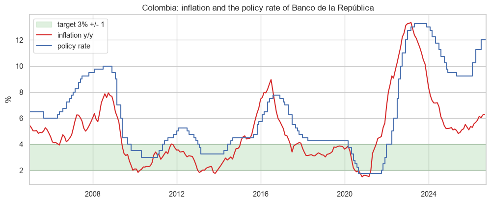
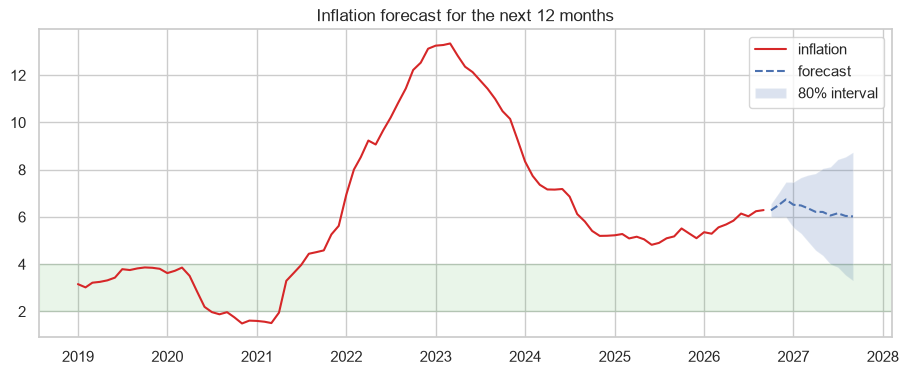

# Colombia: inflation, the peso and Banco de la República

Inflation against the target, a Taylor rule for Banco de la República, the pass-through of the peso to consumer prices and a SARIMA forecast.

## Data
CPI (OECD API, source DANE), policy rate (BIS) and TRM (datos.gov.co).

## Main results
- Inflation is 6.29% (September 2026) and the bank raised the rate from 9.25% to 12% since February 2026.
- Taylor rule with smoothing: long-run response to inflation of 1.53 (respects the Taylor principle), with a very slow adjustment (rho = 0.985).
- Low pass-through: after 12 months only around 4.4% of a depreciation goes to the CPI.
- The SARIMA expects inflation around 6% in September 2027 (80% interval 3.3% to 8.7%).




## How to run

```
pip install -r requirements.txt
jupyter notebook colombia_inflation.ipynb
```

---
Alejandro Lezcano Osorio | Universidad EIA (Colombia) and Rennes School of Business (France)
